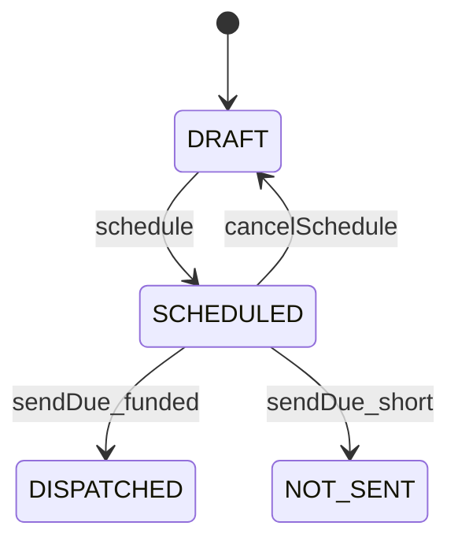
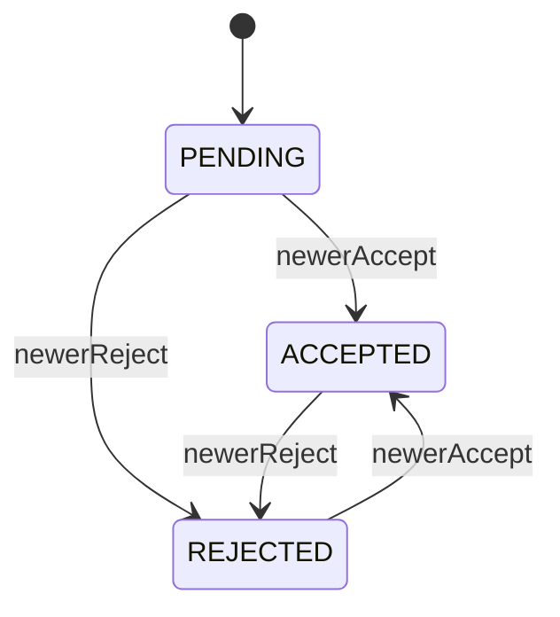
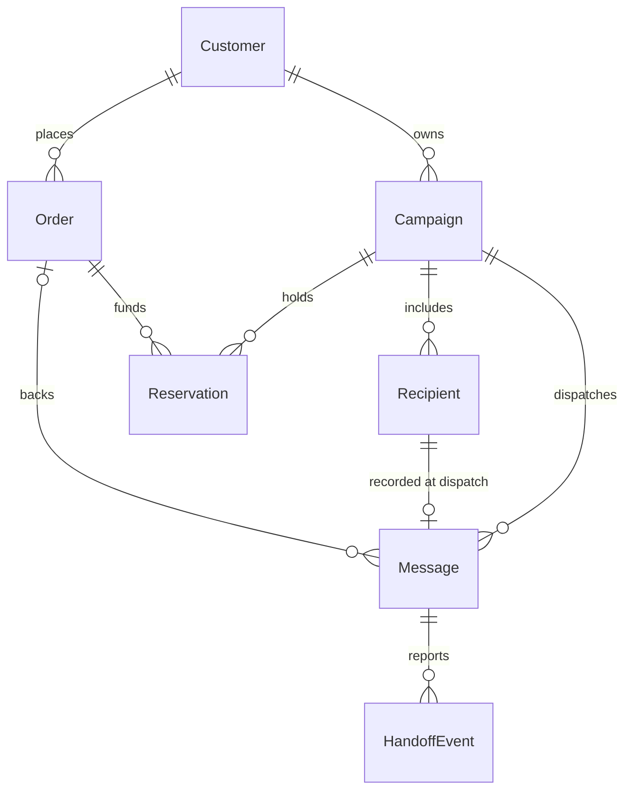

# Prepaid message credits — implementation plan

Planning only until an orchestration run starts. Approval of this plan approves the assumptions below and authorizes one orchestration run that executes all four tasks sequentially. The run continues from one task to the next on its own. A pull request is merged only when a later, separate request says to merge it.

Local `main` is still `18cf261` (NestJS init). GitHub PR [#1](https://github.com/liorale2310/messaging-balance/pull/1) is already merged as `1aae9dd`. Task 1 starts with `git fetch origin` and branches from `origin/main`. The whole stack stays on that fetched commit. `feat/postgres-typeorm-setup` is outside the stack.

Existing foundation to keep: [src/database/database.config.ts](src/database/database.config.ts) (`synchronize: false`, entity glob `*.entity.{ts,js}`, migrations under `src/migrations`), [src/database/data-source.ts](src/database/data-source.ts), [docker-compose.yml](docker-compose.yml) (Postgres 16), and the TypeORM scripts in [package.json](package.json). TypeORM `1.1.3` supports `setLock("pessimistic_write")` and `setOnLocked("skip_locked")`. Node is v26.5.1. No HTTP API and no dispatcher implementation.

## Decisions that shape the design

These become [DECISIONS.md](DECISIONS.md), ordered by how much they change the design. Each records the question, the assumption, why, and what would change if the answer differed.

1. **Credit is committed at schedule time.** Draft edits do not hold credit. A scheduled campaign holds one credit per recipient. Reserving only at send time would let two campaigns promise the same credit and one would fail while the customer is away. Reserving at draft time would block other campaigns the customer has not committed to.

2. **A due campaign is sent once, all or nothing.** `sendDue(at)` either records every recipient as ready for the dispatcher, or marks the campaign `NOT_SENT` with a frozen reason and releases its holds. It does not send a partial list, and a later `sendDue` does not retry it. A partial send needs a victim-selection rule and still leaves some recipients unsent. Leaving it scheduled until a later top-up could send it after the event.

3. **Cancelling an order is always allowed.** Cancellation stands even when that order's credit is reserved or already accepted. The lot leaves availability. Holds on that lot are moved onto other active orders, oldest lot first. Holds that cannot move become a scheduled shortfall or an in-flight message with no backing order. Accepted messages that cannot move stay debt. Refusing cancellation would hide refunds and chargebacks. Folding all of that into a negative "available" number would make the dashboard unable to say why a campaign will not go out.

4. **Orders are FIFO lots. Freed or new credit covers existing obligations before it becomes available.** Oldest `placed_at`, then order id. One private function, `coverOutstanding`, applies free capacity in this order: unbacked in-flight messages, then the earliest scheduled shortfall, then the oldest debt. The remainder is available. This is ordinary control flow inside the service, not a rules engine. Scheduled work is covered before old debt so a top-up saves the campaign that is about to be missed. Paying debt first would do the opposite. A single customer counter could not explain which order was cancelled.

5. **Dispatcher integration contract.** The external dispatcher is not part of this core. Every handoff report it submits must include a globally unique event id, the message id created at dispatch, an outcome of `ACCEPTED` or `REJECTED`, and a sequence. The sequence is a positive integer that the dispatcher increases monotonically for successive results of that same message. The core does not invent sequence numbers and does not order reports by arrival time. Gaps are allowed: sequence 3 still applies if 2 was never delivered. If the dispatcher cannot provide a unique event id and a monotonic per-message sequence, duplicate and out-of-order results are undefined, and the core would have to switch to sticky-accept or refuse reports it cannot order.

6. **The newest sequence wins. Event identity is decided before the sequence is compared.** The same event id with the same message id, outcome, and sequence is an idempotent success and writes nothing new. The same event id with any of those three fields different raises `HANDOFF_CONFLICT` and writes nothing. A different event id that reuses an already-stored `(messageId, sequence)` raises `HANDOFF_CONFLICT` and is not stored. A new event whose sequence is strictly lower than the sequence already applied to the message is stored and does not change the message outcome or credit. A new event with a strictly higher sequence is applied: `ACCEPTED` or `REJECTED` replaces the other. A later rejection releases the credit. A later acceptance charges it from free capacity only, or records debt when none remains. It does not take credit already reserved for another campaign. Equality is not the stale-sequence case. The sequence that is already applied was stored with the event that applied it, so a second event id at that same sequence is the conflict above. Comparing the event id alone would hide a dispatcher bug as a successful no-op.

7. **Available credit never goes below zero. Debt is separate.** Scheduling and adding a recipient to a scheduled campaign are refused when `available` is short. The refusal names available, reserved, and debt. Debt is created only by a cancelled order's already-accepted messages, or by a late acceptance after the released credit was reused. Letting available go negative would make "can I schedule this?" ambiguous.

8. **One campaign is handed to the dispatcher at most once.** Statuses are `DRAFT`, `SCHEDULED`, `DISPATCHED`, and `NOT_SENT`. There is no `COMPLETED` status. Pending, accepted, and rejected counts on the balance already say whether the handoff is finished, and a later sequence must still be able to change credit. Cancel schedule is allowed only from `SCHEDULED` and returns the campaign to `DRAFT`. Changing the send time means cancel, then schedule again. The same `scheduledAt` replay is a no-op. Recipients can change in `DRAFT` freely, and in `SCHEDULED` only when the credit movement succeeds. The list freezes at `DISPATCHED`. An empty campaign cannot be scheduled. A send time in the past is allowed and becomes due on the next `sendDue`.

9. **Order and campaign ids are caller-supplied idempotency keys.** The same order id with the same customer and quantity replays successfully. A different payload for that id conflicts. The same rule applies to creating a campaign. `sendDue` is safe to run twice because the status transition happens inside the customer lock. Handoff event ids follow decision 6.

10. **Concurrency is a customer row lock, taken first, under Read Committed.** Lock order is customer, then orders by id, then campaigns by id, then messages by id. `sendDue` handles one customer per transaction and re-reads due campaigns inside that lock. There is no in-memory balance. Locking campaigns before customers would deadlock with scheduling.

11. **The balance is a projection of current rows, plus one frozen sentence.** Counts are derived inside the locked transaction. Order rows do not cache reserved or consumed counters. There is no ledger table and no event store. Each mutating transaction ends by asserting conservation. A campaign stores `not_sent_reason` when send is refused, because the holds are released and the cause would otherwise disappear. While a scheduled campaign is short, it stores `funding_note`, including the cancelled order that caused the shortfall. Debt and unbacked in-flight text are rendered from current rows. A stored balance blob would drift. A history log is the change to make if the dashboard must show past movements rather than the current position.

12. **Dispatch assigns reserved lots to recipients in a stable order.** Before send, a reservation is a quantity on `(campaign, order)`. At send, recipients are sorted by `created_at` ascending, then recipient `id` ascending. Lots already reserved to that campaign are sorted by `placed_at` ascending, then order `id` ascending. Walking the recipients in order, each takes the next credit from the oldest lot that still has remaining quantity. Address order is not used, because collation would change who is charged to which order. Message rows do not exist before this step.

13. **Out of scope, on purpose.** No accounting HTTP API, dispatcher, provider client, notifications, auth, or cron. No message body, currency, price other than 1 credit, partial order cancel, or expiry. The first `placeOrder` creates the customer. A recipient is a trimmed non-empty string, unique per campaign, with no phone-format canonicalization. Send selection uses the caller’s `at`, not the server clock. Order quantity is a positive integer up to 1,000,000.

14. **Database tests run only against a database whose name ends in `_test`.** Schema changes go through TypeORM migrations only. This keeps a test truncate away from the development database.

## Functional specification

Caller-supplied UUID strings identify customers, orders, and campaigns. Handoff event ids are non-empty strings unique across all messages. One credit sends one recipient.

**Place order.** Creates the customer if needed. Inserts an active lot of `quantity`. Replays with the same id, customer, and quantity return the existing order. A conflicting replay is refused. `coverOutstanding` then runs, so the new credit funds an existing shortfall or debt before any of it becomes available.

**Cancel order.** Allowed from `ACTIVE`, including when credit is reserved or consumed. A second cancel is a no-op. Unknown ids are refused. The lot becomes `CANCELLED`. Its reservation quantities and in-flight messages are detached from it. `coverOutstanding` moves what it can onto other active lots. Accepted messages that remain on the cancelled lot, or that have no lot, count as debt. A scheduled campaign that remains short gets a new `funding_note` naming this order and the current shortfall.

**Campaigns and recipients.** `createCampaign` opens a `DRAFT`. Adding or removing recipients in a draft does not change the balance. Duplicate addresses are refused. Scheduled adds reserve one credit or the add is refused and the recipient is not stored. Scheduled removes drop the recipient. If that recipient was funded, one credit returns through `coverOutstanding`. If the campaign was already short, the shortfall shrinks by one and no credit is released. Edits after `DISPATCHED` are refused.

**Schedule and cancel schedule.** Schedule from `DRAFT` requires at least one recipient and `available >= recipient count`. It writes FIFO reservations and sets `scheduledAt`. Cancel schedule releases those reservations through `coverOutstanding` and returns the campaign to `DRAFT`.

**Send due.** For each customer with a campaign in `SCHEDULED` and `scheduledAt <= at`, inside the customer lock: a fully funded campaign becomes `DISPATCHED` and loses its reservation rows. It gains one `PENDING` / `RESERVED` message per recipient, and no recipient has a message before that. A short campaign becomes `NOT_SENT`, stores the reason (shortfall, recipient count, and the funding note), and releases any partial hold. Campaigns due later stay scheduled. Already dispatched or not-sent campaigns are left alone.

Recipient-to-lot assignment inside that transaction:

- Recipients: `created_at ASC`, `id ASC`.
- Reserved lots: `placed_at ASC`, `order id ASC`.
- Expand each lot into `quantity` single credits and pair them with recipients in that order.

Example: order A reserved 2 and order B reserved 1, with A older than B. Recipients r1, r2, r3 in `(created_at, id)` order. r1 and r2 are backed by A. r3 is backed by B. Running `sendDue` again does not rebuild this assignment.

**Handoff result.** The caller is the dispatcher integration described in decision 5. Unknown messages are refused. Checks run in this order. The payload used for idempotency is `(eventId, messageId, outcome, sequence)`.

- Same event id and identical payload: idempotent success. Do not insert another row and do not change credit.
- Same event id and a different payload: raise `HANDOFF_CONFLICT`. Write nothing.
- Different event id with an already-used `(messageId, sequence)`: raise `HANDOFF_CONFLICT`. Do not store the event.
- New event with a strictly lower sequence than the sequence already applied to the message (`sequence < outcome_sequence`): store the event. Leave the message outcome and credit unchanged.
- New event with a strictly higher sequence (`sequence > outcome_sequence`, or no sequence applied yet): apply it. `ACCEPTED` becomes `ACCEPTED` / `CONSUMED`, charged to its current lot, or to free FIFO capacity, or to debt. `REJECTED` becomes `REJECTED` / `RELEASED`, and any freed credit runs through `coverOutstanding`.

A sequence equal to the applied sequence is not stored as a stale event. That pair was already used by the event that applied it, so rule 3 rejects the new event id. The unique key on `(message_id, sequence)` is that conflict, not the stale-event path.

Sequence comparison uses PostgreSQL `BIGINT` and JavaScript `bigint`. It never uses a JavaScript `number`. `9007199254740993` is greater than `9007199254740992` even though both collapse to the same IEEE value. The `pg` parser for OID 20 (`int8`) is set to return the raw string, and those strings are converted with `BigInt`. These two sequence columns are the only `BIGINT` columns. Counts and quantities stay `INTEGER`. Apply when `$sequence::bigint > outcome_sequence`. Store without applying when `$sequence::bigint < outcome_sequence`. The parameter is bound as a string.

**Balance.** `getBalance(customerId)` returns:

- `available`, `reserved`, `consumed`, `debt`, `unbackedInFlight`
- per order: status, quantity, how much of it is reserved or consumed, placed and cancelled times
- per campaign: status, schedule, recipient count, funded credits, shortfall, pending, accepted, rejected
- `explanations`: current sentences for debt, unbacked in-flight messages, scheduled shortfalls, and frozen not-sent reasons

Identity, checked at the end of every mutating transaction:

```text
sum(active order quantities) = available + backed reserved + consumed on active orders
debt = consumed messages on cancelled orders + consumed messages with no order
available > 0 only when debt = 0, unbacked in-flight = 0, and every scheduled shortfall = 0
```

`reserved` on the dashboard is backed campaign holds plus backed in-flight messages. Draft campaigns are listed and do not affect the numbers. A recipient on a draft or scheduled campaign contributes to the recipient count and has no message row.





## Architecture

One Nest module. TypeORM entities are the domain objects. Two small pure functions are unit-tested without a database. `AccountingService` is the only transaction boundary. No repository interface, domain-event bus, or separate read model.

- [src/accounting/domain/allocation.policy.ts](src/accounting/domain/allocation.policy.ts) — FIFO split and `coverOutstanding`. One function, fixed order, no strategy objects.
- [src/accounting/domain/handoff.policy.ts](src/accounting/domain/handoff.policy.ts) — payload equality and sequence comparison on `bigint`, plus the credit effect of a newer result.
- [src/accounting/domain/balance.projection.ts](src/accounting/domain/balance.projection.ts) — numbers and explanation sentences from a snapshot.
- [src/accounting/accounting.service.ts](src/accounting/accounting.service.ts) — one method per use case: open a transaction, lock the customer, load rows, call the policy, persist, assert conservation.
- [src/accounting/accounting.errors.ts](src/accounting/accounting.errors.ts) — typed refusals with a stable `code` and a customer-readable `message`.
- Entities in [src/accounting/entities](src/accounting/entities) registered from [src/accounting/accounting.module.ts](src/accounting/accounting.module.ts).

The existing `AppController` stays a hello route. Accounting is not exposed over HTTP. Tests call `AccountingService`.

Refusal codes: `INSUFFICIENT_CREDIT`, `EMPTY_CAMPAIGN`, `DUPLICATE_RECIPIENT`, `RECIPIENT_NOT_FOUND`, `CAMPAIGN_NOT_EDITABLE`, `SCHEDULE_CONFLICT`, `ORDER_NOT_FOUND`, `ORDER_CONFLICT`, `INVALID_QUANTITY`, `CAMPAIGN_NOT_FOUND`, `CAMPAIGN_CONFLICT`, `MESSAGE_NOT_FOUND`, `HANDOFF_CONFLICT`.

## Essential behavior and what is left out

Kept, because the books are wrong without it:

- A lot per order, and reservation rows while a campaign is scheduled.
- Debt when an accepted message’s order is cancelled, or when a late acceptance finds no free credit.
- Moving a cancelled order’s holds onto other active lots, and leaving a visible shortfall or an unbacked in-flight message when that fails.
- `coverOutstanding` so a later order or a released credit funds that shortfall before it can be scheduled elsewhere, then settles debt.
- The dispatcher event id and monotonic sequence, compared as `bigint`.
- The conservation assertion after every mutating transaction.

Left out:

- A `COMPLETED` status. Message counts answer the same question.
- An account-event or ledger table. Current rows plus `not_sent_reason` and `funding_note` are the explanation.
- Cached reserved and consumed counters on the order.
- A separate unbilled-charges table. Debt is a query over consumed messages whose order is cancelled or null.
- A pipeline, rule object, or plugin per credit event. `coverOutstanding` is one function.
- Gap detection that waits for a missing sequence.
- HTTP, a dispatcher client, notifications, and message content.

An unbacked in-flight message is a `PENDING` / `RESERVED` row with `order_id` null. It does not need its own entity.

## Schema

Migration is generated from the entities, then CHECK constraints the generator misses are added by hand. `synchronize` stays off.

Messages are created only when a campaign is dispatched. Until then the recipient stands alone, so the relationship is zero or one, not exactly one. `messages.recipient_id` is required and unique.



- `customers`: `id` uuid pk, `created_at`
- `orders`: `id` uuid pk, `customer_id` fk, `quantity` check `1..1000000`, `status` `ACTIVE|CANCELLED`, `placed_at`, `cancelled_at`, check that cancelled time is present exactly when status is cancelled. Index `(customer_id, status, placed_at, id)`. Orders are never deleted.
- `campaigns`: `id` uuid pk, `customer_id` fk, `status` `DRAFT|SCHEDULED|DISPATCHED|NOT_SENT`, `scheduled_at`, `funding_note`, `not_sent_reason`, `created_at`. `SCHEDULED` requires `scheduled_at`. `DRAFT` forbids it. `NOT_SENT` requires `not_sent_reason`. Indexes `(status, scheduled_at)` and `(customer_id)`.
- `recipients`: `id` uuid pk, `campaign_id` fk, `address` varchar(64), `created_at`. Unique `(campaign_id, address)`. Index `(campaign_id, created_at, id)` for dispatch ordering.
- `reservations`: pk `(campaign_id, order_id)`, both fks, `quantity` check `> 0`. These rows exist only while a campaign is `SCHEDULED`.
- `messages`: `id` uuid pk, `campaign_id` fk, `recipient_id` fk unique, `address`, `order_id` fk null, `outcome` `PENDING|ACCEPTED|REJECTED`, `credit_state` `RESERVED|CONSUMED|RELEASED`, `outcome_sequence` `BIGINT` null. `PENDING` pairs with `RESERVED` and a null sequence. `ACCEPTED` pairs with `CONSUMED`. `REJECTED` pairs with `RELEASED`. A non-pending outcome requires a sequence. Index `(order_id)`.
- `handoff_events`: `event_id` text pk, `message_id` fk, `outcome` `ACCEPTED|REJECTED`, `sequence` `BIGINT` check `> 0`, `received_at`. Unique `(message_id, sequence)`.

Foreign keys restrict deletes. The service assertion, not a trigger, enforces cross-table conservation inside the same transaction.

## Git dependency strategy

The four tasks stay four branches and four pull requests. They share one line of history. Each branch contains the previous tasks' commits, and each pull request uses the previous branch as its base. GitHub's comparison is `git diff <base>...<head>`, so the files changed on a pull request are the commits that are on the head and absent from the base.

```text
origin/main  (fetched once, at the start of task 1)
  └── feat/accounting-schema          PR 1 base: main
       └── feat/orders-and-balance    PR 2 base: feat/accounting-schema
            └── feat/campaign-reservations
                 PR 3 base: feat/orders-and-balance
                 └── feat/send-and-handoff
                      PR 4 base: feat/campaign-reservations
```

Task 1 is cut from the fetched `origin/main`. Task 2 is cut from the tip of `feat/accounting-schema` after task 1 is committed and pushed. Task 3 is cut from the tip of `feat/orders-and-balance`. Task 4 is cut from the tip of `feat/campaign-reservations`. `main` still lacks those commits until a person merges the stack, so a later task takes its parent commits from the parent branch.

Before `gh pr create`, `git log <base>..<head>` lists only that task's commits, and `git diff <base>...<head>` shows only that task's product change plus this plan's status update for that task. The parent task's commits are already on the base, so they stay out of the child's file list.

Published history is append-only. The update that is allowed after `git push` is a new commit, pushed with `git push` and no force flag. A defect whose code was introduced on an earlier branch is fixed with a new commit on that owning branch. The suite runs there, the branch is pushed, and each descendant that already exists merges the owning branch in with a merge commit, re-runs the suite, and pushes. The merge moves the child's merge-base forward, so the child's pull request continues to show the child's own product diff. Rebase, amend of a pushed commit, and reset are outside this workflow.

This run opens the four pull requests and leaves them open. Landing them is a later human step, bottom-up, using merge commits: merge PR 1 into `main`, retarget PR 2 onto `main`, merge PR 2, then the same for PR 3 and PR 4. A merge commit keeps the original commit ids reachable from `main`, so after the retarget the next pull request's diff is still that task's own commits. The orchestration run does not retarget bases and does not merge.

## One-run execution

One orchestration request covers all four tasks. The orchestrator does not ask for a new prompt between pull requests.

Rules for the run:

1. Execute task 1, then task 2, then task 3, then task 4, in this same run.
2. Use the stacked bases above. PR 1 targets `main`. Each later PR targets the previous feature branch.
3. Finish the current task — green suite, clean review, commit, push, open pull request, status recorded — before creating the next branch.
4. Keep each pull request's product diff limited to that task.
5. Run the full suite from the Testing section after every task, on the tree that will be pushed.
6. Leave every pull request unmerged. There is no `gh pr merge` in this run, and there is no local merge to `main`.
7. Push with `git push -u origin HEAD` only. A rejected push stops the run. Published commits stay as they are.
8. On a failed test, fix the owning task and run the same suite again, or stop. A failing test stays in the suite.
9. Update the YAML `todos` and the status table in this file on the active task branch.
10. At the end, report every PR URL, branch, base, commit SHA, and validation result.

Per task:

1. Set that task to `in_progress` in the YAML todo and the status table.
2. Create its branch from the base in the diagram. The worktree is clean before the branch is cut.
3. Implement that task's scope below. Leave the other tasks' behavior for their own branches.
4. Run the full suite. When the suite fails, fix it on the owning branch and run it again. When it still fails, leave this task `in_progress`, leave later tasks `pending`, and stop. The stop report names the failing command and covers any pull requests already opened. If lint rewrites files, those edits stay in the tree and the suite runs again.
5. Commit the implementation. The committed tree is the tree the suite passed on.
6. Review `git log <base>..<head>` and `git diff <base>...<head>` against this plan's decisions, architecture, and this task's tests. The review is clean when that log contains only this task's commits and the product diff is this task. A defect found here is a new commit on the owning branch, then the suite again, then this review again. Put the clean review in the pull request body with the behavior, the decisions this task implements, and the test plan.
7. Push, then `gh pr create --base <base> --head <branch>`.
8. Record the PR URL, base, head SHAs, and command results in the status table and YAML todo (`completed`). Commit that plan update and push it. A plan-only status commit does not need a second suite run.
9. Cut the next branch from this tip.

A review defect in the current task is another commit on the current branch, then the suite again. A review defect in a parent task uses the owning-branch fix above, then the review and the suite run again on each branch that received the fix. The next task stays unstarted until the current pull request is open and the suite is green.

Direct commits to `main` are outside this workflow. The product work of a task is one implementation commit when the review is clean the first time. Review fixes and the plan-status commit are extra commits on the same branch. They stay in that pull request.

**PR 1 — `feat/accounting-schema`, base `main`.** Entities, migration, `AccountingModule`, [DECISIONS.md](DECISIONS.md), [docs/erd.md](docs/erd.md), and a README that explains Postgres, migrations, and the test database. The ER diagram uses zero-or-one from recipient to message. Schema tests insert valid rows and expect the checks and unique constraints to reject invalid ones. This PR has the schema and the test harness. Use-case behavior arrives in later pull requests.

**PR 2 — `feat/orders-and-balance`, base `feat/accounting-schema`.** `placeOrder`, `cancelOrder` while no campaign holds exist, and `getBalance` for lots. Idempotent replays, conflicting replays, quantity validation, and the conservation assertion. Its commits sit on top of PR 1.

**PR 3 — `feat/campaign-reservations`, base `feat/orders-and-balance`.** Campaigns, recipients, schedule, cancel schedule, FIFO reservations, cancellation re-home, and shortfall notes. `coverOutstanding` covers scheduled shortfalls. Extend cancel from PR 2 on this branch. Priority tests for insufficient credit and concurrent scheduling live here.

**PR 4 — `feat/send-and-handoff`, base `feat/campaign-reservations`.** `sendDue`, deterministic recipient assignment, messages, handoff policy, bigint sequences, debt, and unbacked in-flight messages. README code map. Priority tests for cancellation after consumption, duplicate and out-of-order handoffs, and `sendDue` idempotency live here.

Done for a task means the branch was cut from the base in the diagram, the full suite passed on the pushed implementation commit, the in-run review is recorded in the pull request body, the pull request is open against that base, and this plan shows `completed` with the URL, SHAs, and command results. Done does not mean merged.

## Orchestration status

The orchestrator updates this table and the YAML `todos` together. `completed` means the pull request is open and the suite passed. It does not mean merged. A failed suite leaves that task `in_progress` and every later task `pending`.

| Task | Branch | PR base | Commits | PR | Validation | Status |
| --- | --- | --- | --- | --- | --- | --- |
| 1 Schema | `feat/accounting-schema` | `main` | `bb0f092`, `5161379`, `f400f47`, `671f012` (head `671f012`, base `1aae9dd`) | https://github.com/liorale2310/messaging-balance/pull/2 | `npm run build` pass; `npm run lint` pass with the existing `src/main.ts` floating-promise warning; `npm test` 10 passed; `DB_NAME=messaging_balance_test npm run test:db` 8 passed | completed |
| 2 Orders | `feat/orders-and-balance` | `feat/accounting-schema` | `4dfc19d`, `b051280`, `5ca7abc` (head `5ca7abc`, base `671f012`) | https://github.com/liorale2310/messaging-balance/pull/3 | `npm run build` pass; `npm run lint` pass with the existing `src/main.ts` floating-promise warning; `npm test` 13 passed; `DB_NAME=messaging_balance_test npm run test:db` 17 passed | completed |
| 3 Campaigns | `feat/campaign-reservations` | `feat/orders-and-balance` | `74cc0f5`, `abdc88a`, `10e955d`, `390d6f5` (head `390d6f5`) | https://github.com/liorale2310/messaging-balance/pull/4 | `npm run build` pass; `npm run lint` pass with the existing `src/main.ts` floating-promise warning; `npm test` 16 passed; `DB_NAME=messaging_balance_test npm run test:db` 23 passed on `74cc0f5`. `10e955d` reverts `abdc88a`, so the file diff against orders is the campaign work. | completed |
| 4 Send | `feat/send-and-handoff` | `feat/campaign-reservations` | `996518d`, `976cf7e`, `0e85daa` (code head `0e85daa`) | https://github.com/liorale2310/messaging-balance/pull/5 | `npm run build` pass; `npm run lint` pass with the existing `src/main.ts` floating-promise warning; `npm test` 22 passed; `DB_NAME=messaging_balance_test npm run test:db` 30 passed on `0e85daa` | completed |

## Testing

Postgres tests use a separate Jest config, `runInBand`, migrations in global setup, and truncate between cases. They refuse to start unless `DB_NAME` ends with `_test`.

```bash
docker compose up -d
docker exec messaging-balance-postgres psql -U messaging_balance -d messaging_balance -c 'CREATE DATABASE messaging_balance_test'
DB_NAME=messaging_balance_test npm run test:db
```

The full suite runs after every task, on the tree that will be committed and pushed, before the next branch is cut:

```bash
npm run build
npm run lint
npm test
DB_NAME=messaging_balance_test npm run test:db
```

Task 1 adds the `test:db` script and the separate Jest config. From task 1 onward, all four commands are the gate. A failing command stops the run. The task stays `in_progress`, and the orchestrator does not drop, skip, or weaken the failing test to continue.

### Priority proofs

These six are the acceptance gate. Other cases are written after the proof that belongs to that PR is green. Conservation is asserted after every mutating test, and one lifecycle test walks the whole identity.

1. **Credit conservation.** After place, reserve, release, send, accept, reject, and cancel: active quantity equals available plus backed reserved plus consumed on active orders; debt matches consumed messages on cancelled or missing orders; available is positive only when nothing outstanding remains.
2. **Order cancellation after consumption.** Accept a message, cancel the order that paid for it, and show the credit as debt rather than available. A later order settles that debt before any of it becomes available. The cancelled lot has no remaining holds.
3. **Campaign reservations and insufficient credit.** Scheduling reduces available by the recipient count. A further schedule or scheduled add that does not fit is refused, and the refused recipient is not stored. Draft edits do not reserve.
4. **Concurrent scheduling.** Two transactions schedule against one remaining credit. One commits and the other receives `INSUFFICIENT_CREDIT`. The final reservation total is one.
5. **Duplicate and out-of-order handoff results.** The same event id and identical payload applied twice consumes once. The same event id with a different outcome, message id, or sequence raises `HANDOFF_CONFLICT` and leaves the balance unchanged. A different event id that reuses an already-stored `(messageId, sequence)` raises `HANDOFF_CONFLICT` and is not stored. A strictly lower sequence is stored and does not change the message outcome. A higher rejection after acceptance releases, and a higher acceptance after rejection charges. One case uses sequences `9007199254740992` and `9007199254740993`, compared as `bigint`, so a JavaScript `number` comparison would fail the test.
6. **`sendDue` idempotency.** A second call, and an overlapping call for the same due campaign, create one message per recipient and move the campaign to `DISPATCHED` once. The backing order on each message follows `(created_at, id)` paired with FIFO lots.

PR 2 owns the conservation assertion for orders. PR 3 owns proofs 3 and 4 and conservation with reservations. PR 4 owns proofs 1 (full lifecycle), 2, 5, and 6.

### Supporting tests

Unit tests, no database: FIFO split, `coverOutstanding` order, and handoff decisions on `bigint` for identical replay, conflicting payload, a reused `(messageId, sequence)`, a strictly lower sequence, and both reversals.

Integration tests around the proofs:

- Conflicting order replay, empty schedule refused, past schedule allowed, cancel schedule releases credit.
- Cancelling the funding order writes a shortfall and names that order.
- `sendDue` before the scheduled time sends nothing. A short campaign becomes `NOT_SENT` and is not retried.
- A late acceptance does not take another campaign’s reservation.
- Cancelling an order while messages are pending re-homes them, or leaves them unbacked.
- New credit backs unbacked in-flight messages before a new schedule can use it.
- Recipient edits and cancel-schedule are refused after dispatch.

Explanation text is asserted where it carries a number or an order id used by a proof. There is no separate test per sentence of dashboard copy.

## Risks

- Branching task 1 from local `main` (`18cf261`) or from `feat/postgres-typeorm-setup` would replay or miss infrastructure history. Task 1 is cut from fetched `origin/main`. Later tasks are cut from the previous feature-branch tip, so they keep the parent commits that `main` does not have yet.
- Opening PR 2, PR 3, or PR 4 against `main` would put every parent commit into that pull request's diff. The base is the parent feature branch, checked with `git log <base>..<head>` before `gh pr create`.
- A rebase or force-push after a child branch exists would rewrite commits the child still points at. A parent fix is a new commit on the owning branch, merged forward into each existing descendant.
- A squash merge onto `main` would replace the parent commit ids and make the next pull request repeat the squashed work. The human landing sequence uses merge commits, bottom-up, then retargets the next pull request onto `main`. This run does not perform that landing.
- Continuing after a red suite would copy a broken parent into every child branch. A failed build, lint, unit, or database command stops the run on that task.
- Recording a task's status on another task's branch would put that bookkeeping into the wrong pull request. Status edits for a task are committed on that task's branch.
- Taking a campaign lock before the customer lock deadlocks `sendDue` against scheduling. One helper takes the customer lock, and every use case uses it.
- A path that frees credit and skips `coverOutstanding` would leave a shortfall beside available credit. The end-of-transaction assertion makes that a failure.
- Unique-violation races on replayed ids must re-read the stored payload. Matching payload returns success. A different payload returns `HANDOFF_CONFLICT`.
- Parsing `BIGINT` with `Number`, `parseInt`, or a numeric comparison drops precision above `2^53 - 1` and can apply an older provider result. The large-sequence test is the guard.
- The late-accept path is the easy place to take reserved credit. The supporting test funds a second campaign on the released credit before the acceptance arrives.
- Scope drift into an HTTP API, a ledger, a `COMPLETED` state machine, or a dispatcher client would bury the accounting model. Those stay out.
