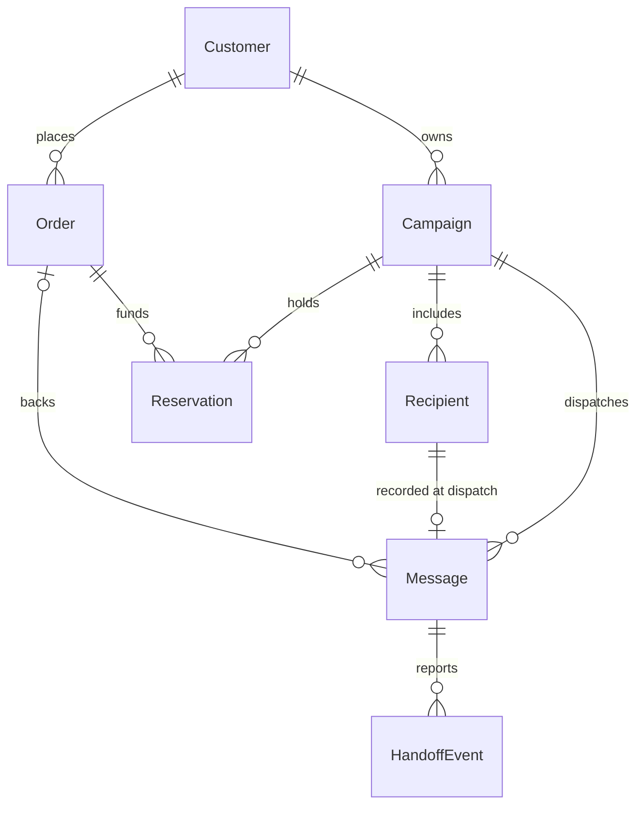

# Credit accounting schema

A recipient has no message until its campaign is dispatched. The relationship is zero or one, not exactly one. `messages.recipient_id` is required and unique, so a recipient never has two messages.

Reservation rows exist only while a campaign is `SCHEDULED`. Message rows exist only after dispatch. An in-flight message may have a null `order_id` when no active lot backs it. Cross-table conservation is asserted by the service in the same transaction. It is not a database trigger.

## Columns

### customers

- `id` uuid primary key
- `created_at` timestamptz

### orders

- `id` uuid primary key
- `customer_id` uuid, foreign key, delete restricted
- `quantity` integer, check 1 through 1,000,000
- `status` `ACTIVE` or `CANCELLED`
- `placed_at` timestamptz
- `cancelled_at` timestamptz, present exactly when status is `CANCELLED`
- index `(customer_id, status, placed_at, id)`
- orders are never deleted

### campaigns

- `id` uuid primary key
- `customer_id` uuid, foreign key, delete restricted
- `status` `DRAFT`, `SCHEDULED`, `DISPATCHED`, or `NOT_SENT`
- `scheduled_at` timestamptz. Required unless the campaign is `DRAFT`, which forbids it
- `funding_note` text, nullable. Set while a scheduled campaign is short
- `not_sent_reason` text. Required exactly when status is `NOT_SENT`
- `created_at` timestamptz
- indexes `(status, scheduled_at)` and `(customer_id)`

### recipients

- `id` uuid primary key
- `campaign_id` uuid, foreign key, delete restricted
- `address` varchar(64), trimmed non-empty
- `created_at` timestamptz
- unique `(campaign_id, address)`
- index `(campaign_id, created_at, id)` for dispatch ordering

### reservations

- primary key `(campaign_id, order_id)`, both foreign keys, delete restricted
- `quantity` integer, check greater than 0

### messages

- `id` uuid primary key
- `campaign_id` uuid, foreign key, delete restricted
- `recipient_id` uuid, foreign key, unique, delete restricted
- `address` varchar(64), trimmed non-empty
- `order_id` uuid, foreign key, nullable, delete restricted
- `outcome` `PENDING`, `ACCEPTED`, or `REJECTED`
- `credit_state` `RESERVED`, `CONSUMED`, or `RELEASED`
- `outcome_sequence` bigint, nullable. The only bigint columns in the schema are this one and `handoff_events.sequence`
- `PENDING` pairs with `RESERVED` and a null sequence
- `ACCEPTED` pairs with `CONSUMED` and a sequence
- `REJECTED` pairs with `RELEASED` and a sequence
- index `(order_id)`

### handoff_events

- `event_id` text primary key, non-empty
- `message_id` uuid, foreign key, delete restricted
- `outcome` `ACCEPTED` or `REJECTED`
- `sequence` bigint, check greater than 0
- `received_at` timestamptz
- unique `(message_id, sequence)`
